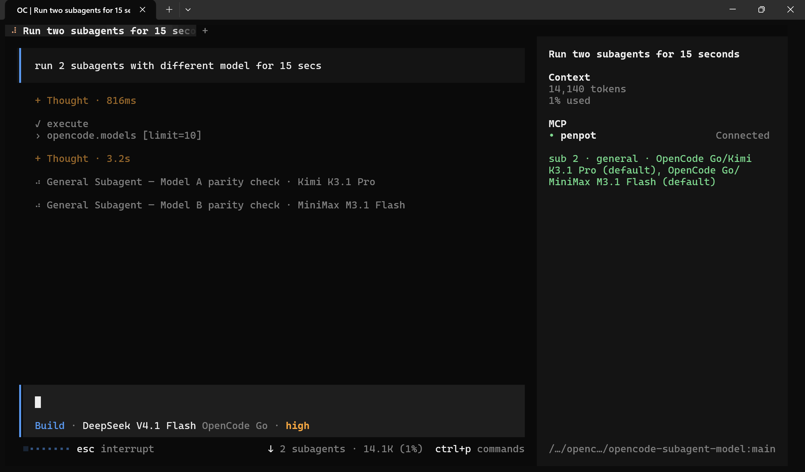

# opencode-subagent-model

Live model status for running subagents in the OpenCode TUI.

This plugin shows which model each active subagent is using, so you can quickly understand what is running without opening each session individually.

## Live preview



## Why use it

- See live model information for each running subagent
- Browse all active subagents from one searchable picker
- Open any subagent session directly from the UI
- Keep the status compact when you want less visual noise

## Example output

Single subagent:

```text
sub explore · OpenAI/GPT-4o · 42s
```

Multiple subagents:

```text
sub 3 · explore x2, general · OpenAI/GPT-4o x2, Anthropic/Claude Sonnet 4
```

## Features

- Live status summary in the session UI (`sidebar.content` by default)
- `/subagents` command and `/subagent-models` alias
- Palette command: `Show running subagent models`
- Palette command: `Toggle compact subagent status`
- Type-to-filter picker for agent, model, title, and elapsed time
- Direct open action for each subagent session

## How it works

The plugin inspects the active session family and shows child sessions that are currently marked as `running`.

It resolves the model in this order:

1. the session model
2. the subagent's configured agent model
3. the nearest parent session model
4. `unknown model`

The displayed label follows the format `ProviderName/ModelName`, and appends ` (variant)` when relevant. If a label is missing, the plugin falls back to the provider or model ID.

## Commands

### `/subagents`

Opens a searchable list of running subagents.

It includes:

- agent name
- resolved model
- session title
- elapsed time
- session ID

Type to filter the list. Press Enter to open the selected session, or use `alt+o` to open it without closing the picker.

Example:

```text
/subagents explore
```

### Palette commands

- `Show running subagent models`
- `Toggle compact subagent status`

## Configuration

Add the plugin in `opencode.jsonc`:

```jsonc
{
  "plugins": [
    {
      "package": "opencode-subagent-model",
      "options": {
        "placement": "sidebar.content",
        "bind": "ctrl+shift+s",
        "compact": false
      }
    }
  ]
}
```

### Options

| Option | Type | Default | Meaning |
|---|---|---|---|
| `placement` | `"sidebar.content"` \| `"sidebar.footer"` \| `"prompt.footer"` | `"sidebar.content"` | Where the live status is rendered |
| `bind` | `string` | unset | Keybind for the subagent picker |
| `compact` | `boolean` | unset | Forces compact mode (`sub N`) |

## Installation

The plugin is discovered from the OpenCode plugin directories.

Global config path:

```text
~/.config/opencode/plugins/opencode-subagent-model/
```

Project-local path:

```text
<project>/.opencode/plugins/opencode-subagent-model/
```

You can also symlink the plugin directory into place:

```sh
ln -s /path/to/opencode-subagent-model ~/.config/opencode/plugins/opencode-subagent-model
```

After installation, reload the TUI with `/reload` or restart OpenCode.

## Development

```sh
npm install
npm run typecheck
npm test
```

## Repository layout

```text
package.json             package metadata and exports
src/index.ts             plugin bootstrap entry
src/tui.tsx              TUI commands, slots, and dialogs
src/lib/collect.ts       model resolution and summary logic
src/lib/collect.test.ts  unit tests for the data layer
```

## License

MIT
